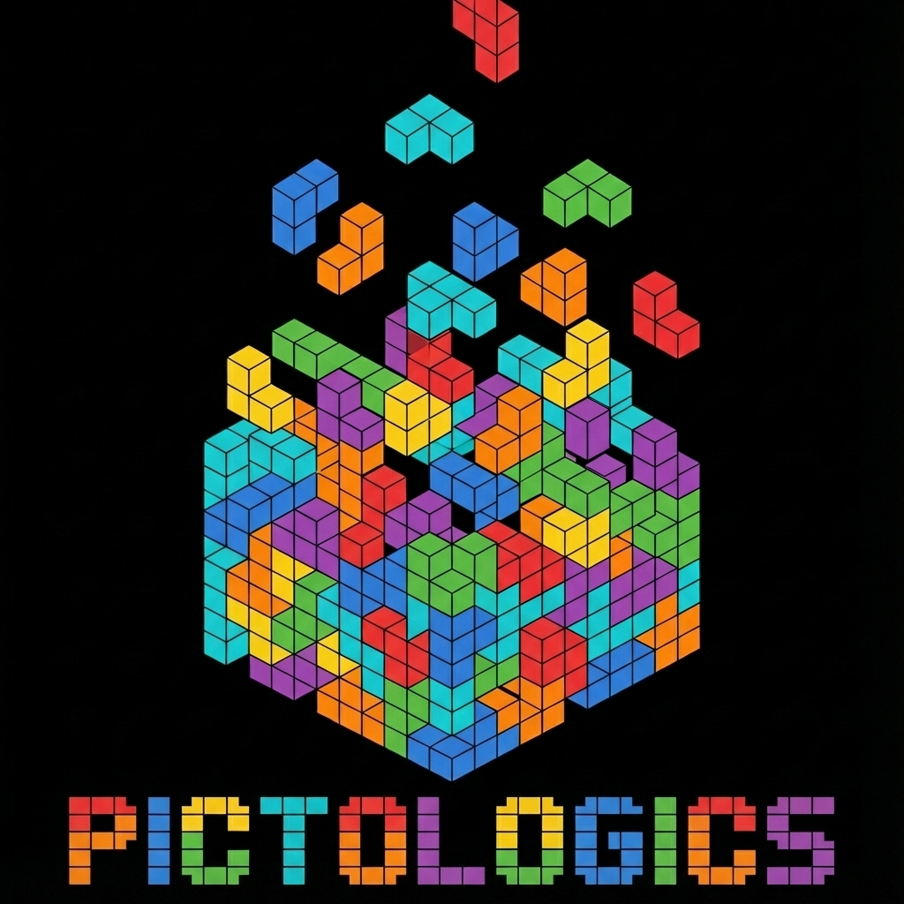

# Welcome to Pictologics

[](https://github.com/martonkolossvary/pictologics/actions/workflows/ci.yml)
[](https://martonkolossvary.github.io/pictologics/)
[](https://pypi.org/project/pictologics/)
[](https://pypi.org/project/pictologics/)
[](https://pypi.org/project/pictologics/)
[](https://github.com/martonkolossvary/pictologics/blob/main/LICENSE)
[](https://codecov.io/gh/martonkolossvary/pictologics)
[](https://github.com/astral-sh/ruff)
[](https://mypy-lang.org/)


{ align=right width=200 }

**Pictologics** is a Python library for radiomic feature extraction from medical images. It follows IBSI 1 (the features) and IBSI 2 (the filters), and it checks its results against the IBSI reference values.

See the [NOTICE](NOTICE.md) file for the attribution and the third-party libraries.

## Why Pictologics?

*   **🚀 Fast**: Numba compiles the computations for your computer, and they run on its fast cores. The [Benchmarks](benchmarks.md) page gives the time of each part.
*   **✅ IBSI compliant**: checked against the IBSI phantoms and data sets:
    *   **IBSI 1** (features): 675 feature values pass; 21 more have a reference value without a tolerance ([report](ibsi1_compliance.md)).
    *   **IBSI 2 Phase 1** (filters): 28 of 28 compared tests pass ([report](ibsi2_compliance.md)).
    *   **IBSI 2 Phase 2** (filtered features): 9 of 9 tests pass ([report](ibsi2_phase2_compliance.md)).
    *   **IBSI 2 Phase 3** (reproducibility): 153 scans, compared with 9 teams ([report](ibsi2_phase3_compliance.md)).
*   **🔧 Versatile**: reads NIfTI, NRRD, MetaImage and DICOM images, DICOM SEG, DICOM RTSTRUCT and 3D Slicer segmentations, and DICOM SR reports.
*   **✨ Easy to use**: pip installs it. One pipeline runs the preprocessing and the features, for one image or for a whole study.
*   **🛡️ Predictable results**: each configuration gives all its feature columns, also when a step fails (the values are then `NaN`). A study table never has missing columns.
*   **🛠️ Maintained**: Pictologics is developed to give robust radiomic features that describe the morphology of diseases on radiological images.

## What Is New in 0.8.0

- **Speed**: on a 512×512×200 CT, timed by turns with 0.7.1 on one computer, the configuration `standard_fbn_32` takes 11 % less time, the six standard configurations 20 % less, and `run_rois` with 20 ROIs 12 % less. Against 0.6.0 that is 64 %, 56 % and 89 % less.
- **Resampling**: cubic resampling runs on numba kernels that give the output of scipy bit for bit: the IBSI 2 CT phantom to 1 mm takes about 20 ms instead of 900 ms. A column-order image, for example from nibabel's `get_fdata()`, resamples up to 10 times faster. The pipeline casts an in-memory float32 or integer image where it reads it: `run()` of a float32 CT with the intensity features takes 1 ms instead of 34 ms, with 1.8 MB instead of 400 MB.
- **Filters**: the mean, Gaussian, Laws and wavelet filters run their 1-D passes in numba kernels with the arithmetic of scipy: the same bits, 2 to 5 times faster on a 256³ image. A large LoG runs its FFT in slabs, 30 % faster with 30 % less memory. A filter that computes only the ROI region keeps that region, so a small ROI in a large CT costs much less time and memory.
- **Files**: `save_image` writes a 512×512×200 `.nii.gz` file in 0.8 s instead of 6.8 s, and `load_image` reads it 4 times faster. A mask keeps its stored integer type: 100 MB instead of 450 MB for a uint8 mask of that size. The DICOM database and SR scans of small batches run in the calling process: 1.2 s instead of 2.7 s for 2,000 files.
- **Features**: the histogram, the intensity-volume histogram, the local intensity peaks, the percentiles of small ROIs, Moran's I and Geary's C (a real-spectrum FFT, in slabs when the grid does not fit half of the memory), the GLCM and GLRLM row passes, and the morphology kernels (a third less peak memory, the convex hull from the voxel grid) run faster with the same bits.
- **Memory**: on Windows, the FFT of Moran's I and Geary's C no longer assumes 8 GiB of memory: a body ROI of a 512×512×200 CT takes 0.9 s instead of about 10 hours. Every computer may use half of its memory for it. The Simoncelli and Riesz table caches keep two image shapes: 182 MB instead of 872 MB after 21 scans.
- **Fixes**: the intensity mask stays inside the morphological mask after `keep_largest_component` or `binarize_mask` on the morphological mask only; the GLDZM raises on voxels outside the distance mask instead of dropping zones; a DICOM position written as text no longer fails the loader; a `.nii.gz` file of two gzip members no longer hangs; the convex hull volume no longer loses digits deep in a large grid; the histogram features of float32 values sum in float64; the filters check their parameters; and more (55 entries).
- **Changes**: every mask type takes one threshold rule in a linear mask resample (a few phase 3 values near zero move, with no verdict change); the MVEE stop rule moves `volume_density_mvee` and `area_density_mvee` by 0.2 to 0.5 %; the mean filter and the Laws energy sum each window on its own (within one float32 unit); the LoG of a float64 image is one FFT from 131,072 voxels; the energy sums in a fixed order. The IBSI compliance is the same. See the [Changelog](CHANGELOG.md).
## Key Features

*   **Loaders**: NIfTI, NRRD, MetaImage and DICOM images (also compressed and multiframe DICOM, cardiac phases and PET in SUV), DICOM SEG, DICOM RTSTRUCT and 3D Slicer `.seg.nrrd` masks, and DICOM SR reports.
*   **Preprocessing**: resampling, resegmentation, outlier filtering, the largest component, mask growing and rings in mm, label selection, MR normalisation and discretisation (FBN, FBS and fixed cutoffs).
*   **Features**: the IBSI 1 families: morphology, intensity statistics, intensity histogram, intensity-volume histogram (IVH), local and spatial intensity, and the texture matrices GLCM, GLRLM, GLSZM, GLDZM, NGTDM and NGLDM.
*   **Filters**: the IBSI 2 filters: mean, Gaussian, Laplacian of Gaussian, Laws, Gabor, separable wavelets, Simoncelli and Riesz.
*   **Pipeline**: named configurations of steps, many ROIs (`run_rois`), many cases in parallel (`run_batch`), templates, and shared work between configurations.
*   **Reproducibility**: configurations as YAML or JSON files, a feature catalog (`describe_features`), and a processing log with the configuration hash and the versions.
*   **Utilities**: a DICOM database of patients, studies and series, slice viewers for quality checks, and DICOM SR measurement tables.

## A First Example

```python
from pictologics import RadiomicsPipeline, format_results, save_results

pipeline = RadiomicsPipeline()
results = pipeline.run("ct.nii.gz", "lesion.nii.gz", subject_id="p001", config_names=["standard_fbs_16"])
save_results([format_results(results, meta={"subject_id": "p001"})], "features.csv")
```

## Getting Started

1.  **Install**: see [Installation](user_guide/installation.md).
2.  **Run a first example**: see the [Quick Start](user_guide/quick_start.md).
3.  **Learn the pipeline**: see [The Pipeline](user_guide/pipeline.md) and [Pipeline Steps](user_guide/pipeline_steps.md).
4.  **Find a script for your task**: see the [Cookbook](user_guide/cookbook.md) and the tutorials.
5.  **Look up a function**: see the [API Reference](api/pipeline.md).
